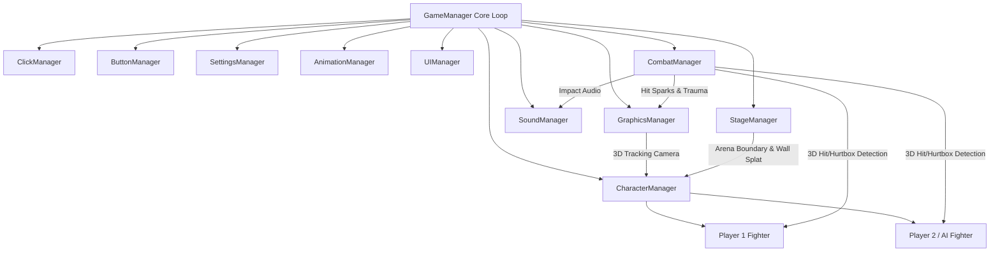

# DARKLOTUS Engine Architecture & Design

## 1. Overview
**DarkLotus** is a specialized 3D fighting game engine built in C++17 inspired by **Tekken 8**. It is designed with modularity, clean separation of concerns, and specialized manager classes handling distinct subsystems.



---

## 2. Specialized Managers

### 1. `ClickManager`
- Tracks mouse cursor, drag deltas, double clicks, and button states.
- Casts 3D rays from screen coordinates into the 3D fighting arena (`GetScreenToWorldRay`).
- Performs 3D raycast tests against bounding boxes and ground planes for interaction and debugging.

### 2. `ButtonManager`
- Manages UI Buttons with interactive states (Normal, Hovered, Pressed, Disabled) and click callbacks.
- Polls the **Tekken 4-button fighting input layout**:
  - `1`: Left Punch (LP)
  - `2`: Right Punch (RP)
  - `3`: Left Kick (LK)
  - `4`: Right Kick (RK)
  - Simultaneous combinations (`1+2`, `3+4`, `1+3` Throw, `2+4` Throw, `Heat/Rage`).
- Maintains an **input history circular buffer** (60 frames) to reliably detect combo inputs without dropped frames.
- Supports both Keyboard and Gamepad/Controller simultaneously.

### 3. `SettingsManager`
- Manages video configurations: Resolution, Fullscreen, VSync, 60 FPS target, Bloom, and Hit Sparks.
- Audio volume controls: Master, BGM, SFX, Voice.
- Gameplay tournament rules: Rounds to win (First to 2/3), Round time limit, AI difficulty.
- Serializes and deserializes configurations to `assets/config/settings.cfg`.

### 4. `GraphicsManager`
- Initializes Raylib window, OpenGL context, and 4x MSAA anti-aliasing.
- **Tekken 3D Dynamic Camera**:
  - Tracks the dynamic midpoint between both fighters.
  - Dynamically zooms in/out based on distance between fighters.
  - Orbits subtly during lateral sidestepping.
  - Implements non-linear trauma camera shake on heavy impacts and Counter Hits.
- **Cinematic Slow-Motion**: Slows time scale during round-deciding trades or counter-hit freezes.
- **Particle System**: Spawns 3D directional hit sparks and electric bursts upon strike confirmation.

### 5. `CharacterManager`
- Maintains the playable roster: **LOTUS** (Mishima Karate), **KAGE** (Shadow Ninjutsu), and **RAIJIN** (Thunder Brawler).
- Manages Player 1 and Player 2 fighter instances, character select podiums, and match initialization.
- Dispatches inputs from `ButtonManager` and executes 60 FPS fixed character updates.

### 6. `AnimationManager`
- Manages animation clips, FPS timing, frame counts, and loop states.
- Frame-event system triggering gameplay callbacks (e.g., spawning active hitboxes at Frame 10, closing at Frame 12).
- Procedural bone posing and curve interpolation for fluid character motion.

### 7. `UIManager`
- **Tekken 8 Combat HUD**:
  - Health bars with recoverable red health and yellow damage lag drain.
  - Fighter nameplates and tournament round diamond counters.
  - Central digital round timer.
  - Tekken Blue Heat Gauge and pulsing Red Rage Aura when HP <= 25%.
  - Combo Counter ("3 HITS - 48 DMG").
  - Dynamic combat popups: "COUNTER HIT", "PUNISH", "K.O.".
- Main Menu, Character Select, Settings, and Pause overlays.

### 8. `CombatManager`
- **3D Collision Engine**: Sphere-to-box collision testing between attacker Hitbox and defender Hurtboxes.
- **Tekken Guard Logic**:
  - Standing Guard blocks HIGH and MID attacks; vulnerable to LOW sweeps.
  - Crouch Guard ducks under HIGH attacks (whiff punish opportunity!) and blocks LOW; vulnerable to MID attacks.
- **Counter-Hit Engine**: Deals 125% damage and frame advantage if defender is struck during move startup.
- **Air Juggle Engine**: Propels defenders into the air with vertical velocity, enabling juggling before landing.
- **Damage Scaling**: Progressively scales down juggle damage for balanced combos.

### 9. `SoundManager`
- Procedurally synthesizes retro-futuristic arcade fighting sounds on startup (light punches, heavy thuds, metallic blocks, counter-hit bass booms, whooshes, UI clicks) without requiring external audio files.
- Supports external `.wav` / `.ogg` files when placed in `assets/sounds/`.

### 10. `StageManager`
- Renders 3D arena environments: Neon Cyber Dojo, Dark Lotus Sanctuary, and Infinite Void.
- Enforces arena boundaries and triggers **Tekken Wall Splat** when fighters are hit into stage perimeters.

---

## 3. Directory Structure
```
DarkLotus/
├── assets/                  # Shaders, models, sounds, configurations
├── blender/                 # Blender Python exporter & mannequin generator
├── docs/                    # Technical documentation
├── include/DarkLotus/       # Public modular C++ headers
│   ├── Core/                # GameManager, Common, Types
│   ├── Managers/            # 10 specialized managers
│   ├── Entities/            # Fighter, Hitboxes, Hurtboxes
│   └── Utils/               # Logger, Math, File helpers
├── src/                     # C++ implementations
├── third_party/raylib/      # Prebuilt Raylib library & headers
├── CMakeLists.txt           # CMake build configuration
└── Makefile                 # High-performance Makefile
```
